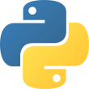

<header class="doc-intro">
  
Python simplicity, native performance.

  <h1 class="codon-logo-heading" aria-label="Codon"></h1>
  
A high-performance Python implementation that compiles to native machine code, with native multithreading and seamless Python interoperability.

</header>

<figure class="codon-pipeline" aria-label="From Python source to native machine code" data-codon-pipeline>
  

    
Input

    

    
Output

  

  <svg class="pipeline-connectors" aria-hidden="true" focusable="false"></svg>
  

    

    
Write familiar Python, then compile and run it with Codon.

    
Python's syntax and semantics, represented as a tree that the compiler can analyze.

    
Static type checking and inference enable native code generation, without requiring type annotations.

    
A rich intermediate representation supports compiler analyses, transformations, and optimizations.

    
General-purpose, Python-specific, and domain-specific optimizations turn high-level code into efficient native programs.

    
LLVM lowers the optimized program to native machine code for your target hardware.

    

  

  

    

      <a class="pipeline-label" id="pipeline-label-source" href="/start/usage/" data-pipeline-label="source" tabindex="-1"><small aria-hidden="true">00</small><strong>Python code</strong></a>
    

    

      <a class="pipeline-label" id="pipeline-label-ast" href="/developers/compilation/#parsing" data-pipeline-label="ast" tabindex="-1"><small aria-hidden="true">01</small><strong>Syntax tree</strong></a>
      <a class="pipeline-label" id="pipeline-label-types" href="/developers/compilation/#type-checking" data-pipeline-label="types" tabindex="-1"><small aria-hidden="true">02</small><strong>Type checking</strong></a>
      <a class="pipeline-label" id="pipeline-label-ir" href="/developers/ir/" data-pipeline-label="ir" tabindex="-1"><small aria-hidden="true">03</small><strong>Codon IR</strong></a>
      <a class="pipeline-label" id="pipeline-label-optimizations" href="/developers/compilation/#codon-ir-optimization" data-pipeline-label="optimizations" tabindex="-1"><small aria-hidden="true">04</small><strong>Optimization</strong></a>
    

    

      <a class="pipeline-label" id="pipeline-label-native" href="/developers/compilation/#code-generation" data-pipeline-label="native" tabindex="-1"><small aria-hidden="true">05</small><strong>Native code</strong></a>
    

  

  

    <svg class="pipeline-track" aria-hidden="true"><defs><marker id="pipeline-arrowhead" markerWidth="7" markerHeight="7" refX="6" refY="3.5" orient="auto"><path d="M1 1 L5 3.5 L1 6" /></marker><mask id="pipeline-flow-mask" maskUnits="userSpaceOnUse"></mask></defs><path class="pipeline-track-base" marker-end="url(#pipeline-arrowhead)" mask="url(#pipeline-flow-mask)" /><path class="pipeline-track-flow" mask="url(#pipeline-flow-mask)" /></svg>
    

      <a class="pipeline-stage pipeline-source pipeline-node" href="/start/usage/" data-pipeline-node="source" aria-labelledby="pipeline-label-source" aria-describedby="pipeline-source-info">
        
          
          
            add.pyPY
            <b>def</b> <em>add</em>(a, b):    <b>return</b> a + b result = <em>add</em>(<i>2</i>, <i>3</i>)
            UTF-8Python
          
        
      </a>
      <a class="pipeline-stage pipeline-node" href="/developers/compilation/#parsing" data-pipeline-node="ast" aria-labelledby="pipeline-label-ast" aria-describedby="pipeline-ast-info">
        
          
          +<small>binary op</small><svg class="pipeline-branches" viewBox="0 0 184 32"><path d="M92 0V10Q92 16 86 16H52Q46 16 46 22V32M92 10Q92 16 98 16H132Q138 16 138 22V32" /></svg>a<small>name</small>b<small>name</small>
        
      </a>
      <a class="pipeline-stage pipeline-node" href="/developers/compilation/#type-checking" data-pipeline-node="types" aria-labelledby="pipeline-label-types" aria-describedby="pipeline-types-info">
        
          
          +<small>int</small><svg class="pipeline-branches" viewBox="0 0 184 32"><path d="M92 0V10Q92 16 86 16H52Q46 16 46 22V32M92 10Q92 16 98 16H132Q138 16 138 22V32" /></svg>a<small>int</small>b<small>int</small>
        
      </a>
      <a class="pipeline-stage pipeline-node" href="/developers/ir/" data-pipeline-node="ir" aria-labelledby="pipeline-label-ir" aria-describedby="pipeline-ir-info">
        
          
          call<small>int.__add__</small><svg class="pipeline-branches" viewBox="0 0 184 32"><path d="M92 0V10Q92 16 86 16H52Q46 16 46 22V32M92 10Q92 16 98 16H132Q138 16 138 22V32" /></svg>%a<small>int</small>%b<small>int</small>
        
      </a>
      <a class="pipeline-stage pipeline-node" href="/developers/compilation/#codon-ir-optimization" data-pipeline-node="optimizations" aria-labelledby="pipeline-label-optimizations" aria-describedby="pipeline-optimizations-info">
        
          
          add<small>i64</small><svg class="pipeline-branches" viewBox="0 0 184 32"><path d="M92 0V10Q92 16 86 16H52Q46 16 46 22V32M92 10Q92 16 98 16H132Q138 16 138 22V32" /></svg>%a<small>i64</small>%b<small>i64</small>
        
      </a>
      <a class="pipeline-stage pipeline-native pipeline-node" href="/developers/compilation/#code-generation" data-pipeline-node="native" aria-labelledby="pipeline-label-native" aria-describedby="pipeline-native-info">
        
          <svg class="pipeline-chip-pattern" viewBox="0 0 344 344" preserveAspectRatio="none" aria-hidden="true" focusable="false"><path class="pipeline-chip-frame" d="M38 20H306L324 38V306L306 324H38L20 306V38Z" /><g class="pipeline-chip-pins"></g><path class="pipeline-chip-traces" d="M62 44H282L300 62V282L282 300H62L44 282V62ZM114 44V34H100V20M230 44V34H244V20M300 114H310V100H324M300 230H310V244H324M114 300V310H100V324M230 300V310H244V324M44 114H34V100H20M44 230H34V244H20" /></svg>
          
          x86-64<b>lea</b> rax,    [rdi + rsi]<b>ret</b>RAXRDIRSI
        
      </a>
    

  

</figure>

  <section class="doc-start" aria-labelledby="goals">
    

      
GET STARTED

      <h2 id="goals">Build your first native program.</h2>
      
Keep the Python syntax you know. Compile to native machine code, run across cores, and connect to the Python ecosystem.

    

    

      <a class="doc-primary-link" href="/start/install/"><svg class="doc-icon" aria-hidden="true" focusable="false"><use href="/img/doc-icons.svg#terminal" /></svg>Install Codon<svg class="doc-icon doc-arrow" aria-hidden="true" focusable="false"><use href="/img/doc-icons.svg#arrow-right" /></svg></a>
      <a class="doc-text-link" href="/language/overview/"><svg class="doc-icon" aria-hidden="true" focusable="false"><use href="/img/doc-icons.svg#book-open" /></svg>Explore the language<svg class="doc-icon doc-arrow" aria-hidden="true" focusable="false"><use href="/img/doc-icons.svg#arrow-right" /></svg></a>
      <a class="doc-text-link" href="/libraries/api/"><svg class="doc-icon" aria-hidden="true" focusable="false"><use href="/img/doc-icons.svg#braces" /></svg>Browse the API reference<svg class="doc-icon doc-arrow" aria-hidden="true" focusable="false"><use href="/img/doc-icons.svg#arrow-right" /></svg></a>
    

  </section>

  <section class="doc-use-section" aria-labelledby="uses">
    
PUT CODON TO WORK

    <h2 id="uses">What will you build with Codon?</h2>
    
Build standalone applications, explore parallel computing, or bring native code into your Python projects.

    

      <a class="doc-use-case" href="/start/usage/">
        <svg class="doc-icon doc-use-icon" aria-hidden="true" focusable="false"><use href="/img/doc-icons.svg#terminal" /></svg>
        <h3>Compile, don't rewrite.</h3>
        
Turn compute-heavy Python into native executables for servers and edge devices, without moving to another language.

        Compile your first program<svg class="doc-icon doc-arrow" aria-hidden="true" focusable="false"><use href="/img/doc-icons.svg#arrow-right" /></svg>
      </a>
      <a class="doc-use-case" href="/parallel/multithreading/">
        <svg class="doc-icon doc-use-icon" aria-hidden="true" focusable="false"><use href="/img/doc-icons.svg#cpu" /></svg>
        <h3>Put every core to work.</h3>
        
Spread independent work across CPU cores with native multithreading. No global interpreter lock holding it back.

        Explore multithreading<svg class="doc-icon doc-arrow" aria-hidden="true" focusable="false"><use href="/img/doc-icons.svg#arrow-right" /></svg>
      </a>
      <a class="doc-use-case" href="/parallel/gpu/">
        <svg class="doc-icon doc-use-icon" aria-hidden="true" focusable="false"><use href="/img/doc-icons.svg#layers" /></svg>
        <h3>Take Python to the GPU.</h3>
        
Write GPU kernels in Python and bring massively parallel hardware to your data-intensive computations.

        Write a GPU kernel<svg class="doc-icon doc-arrow" aria-hidden="true" focusable="false"><use href="/img/doc-icons.svg#arrow-right" /></svg>
      </a>
      <a class="doc-use-case" href="/libraries/numpy/">
        <svg class="doc-icon doc-use-icon" aria-hidden="true" focusable="false"><use href="/img/doc-icons.svg#grid" /></svg>
        <h3>Get more from NumPy.</h3>
        
Keep familiar array operations. Let the compiler fuse expressions and optimize the numerical work underneath.

        Meet Codon's NumPy<svg class="doc-icon doc-arrow" aria-hidden="true" focusable="false"><use href="/img/doc-icons.svg#arrow-right" /></svg>
      </a>
      <a class="doc-use-case" href="/integrations/python/codon-from-python/">
        <svg class="doc-icon doc-use-icon" aria-hidden="true" focusable="false"><use href="/img/doc-icons.svg#zap" /></svg>
        <h3>Start with the bottleneck.</h3>
        
JIT-compile performance-sensitive functions inside an existing Python project. Keep the rest of your application in place.

        Add Codon to Python<svg class="doc-icon doc-arrow" aria-hidden="true" focusable="false"><use href="/img/doc-icons.svg#arrow-right" /></svg>
      </a>
      <a class="doc-use-case" href="/integrations/python/extensions/">
        <svg class="doc-icon doc-use-icon" aria-hidden="true" focusable="false"><use href="/img/doc-icons.svg#blocks" /></svg>
        <h3>Build a faster Python module.</h3>
        
Package native code as a Python extension that other projects can import. No C or Cython required.

        Create an extension<svg class="doc-icon doc-arrow" aria-hidden="true" focusable="false"><use href="/img/doc-icons.svg#arrow-right" /></svg>
      </a>
    

  </section>

  <section class="doc-lab-invitation" aria-labelledby="doc-labs-title">
    <svg class="doc-icon doc-lab-icon" aria-hidden="true" focusable="false"><use href="/img/doc-icons.svg#flask" /></svg>
    

      
CODON LABS

      <h2 id="doc-labs-title">Go from reading to building.</h2>
      
Work through hands-on projects and explore what native Python can do.

    

    <a class="doc-text-link" href="/labs/">Explore the labs<svg class="doc-icon doc-arrow" aria-hidden="true" focusable="false"><use href="/img/doc-icons.svg#arrow-right" /></svg></a>
  </section>

  <section class="doc-compatibility" aria-labelledby="non-goals">
    <svg class="doc-icon" aria-hidden="true" focusable="false"><use href="/img/doc-icons.svg#info" /></svg>
    

      <h2 id="non-goals">Familiar Python. A different runtime.</h2>
      
Codon stays close to Python's syntax and semantics, but it is not a drop-in replacement for CPython. Some dynamic behavior and library interfaces differ. <a href="/integrations/python/python-from-codon/">Python interoperability</a> lets you keep using Python libraries alongside native code.

      <a class="doc-text-link" href="/language/overview/#differences-with-python">Read the compatibility guide<svg class="doc-icon doc-arrow" aria-hidden="true" focusable="false"><use href="/img/doc-icons.svg#arrow-right" /></svg></a>
    

  </section>

